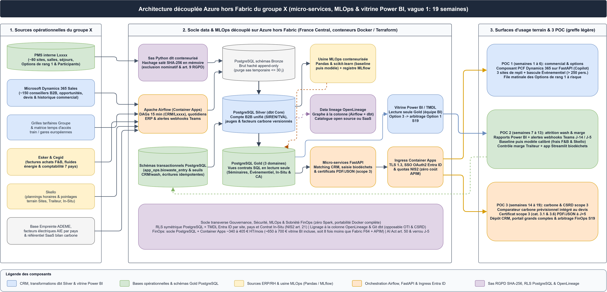

# Plateforme data et MLOps du groupe X (2027 à 2030)

Ce dépôt présente une étude de cas complète d'architecture data et MLOps conçue pour le mandat de Head of Data au sein de la Direction digitale d'un opérateur européen de séminaires et d'événementiel B2B (anonymisé ici sous le nom de **groupe X**). Il rassemble la note exécutive d'architecture, la topologie technique éditable, l'argumentaire de soutenance et la version publique caviardée du support interactif de 29 diapositives.

## Contexte économique et parti pris d'ingénierie

À l'échelle consolidée 2025, le groupe X réalise près de 290 M€ de chiffre d'affaires, accueille environ 650 000 participants sur ~15 500 événements auprès de ~5 200 entreprises clientes actives et maintient un NPS supérieur à 85 à travers près de 80 sites répartis dans 7 pays européens. Derrière cette progression des volumes, les comptes sociaux du périmètre français montrent une contraction du taux d'EBITDA d'environ 14 % en 2022 (~21 M€ pour ~152 M€ de CA) à 5,5 % en 2025 (~10,3 M€ pour ~186 M€ de CA) sous l'effet de l'inflation alimentaire, énergétique, salariale et locative dans un modèle forfaitaire tout-compris. Regagner un seul point d'EBITDA en France représente ~1,85 M€ de marge opérationnelle additionnelle (~2,90 M€ à l'échelle du groupe). Dans le même temps, la vente directe affronte l'essor des courtiers B2B dopés à l'IA (Naboo, Kactus), l'intégration verticale des foncières tertiaires (Icade/Comet, IWG/Wojo) et l'obligation de fournir aux grands comptes du CAC 40 des bilans carbone scope 3 auditables.

Cinq années d'historique structuré sur l'ensemble du système d'information (PMS interne `Lxxxx`, `Microsoft Dynamics 365 Sales`, `Cegid`, `Esker`, `Skello`, référentiel SaaS bilan carbone) représentent moins de 50 Go de données utiles, avec des cycles de décision quotidiens et un seul flux au quart d'heure sur les disponibilités de salles. Face à cette volumétrie modérée et à une marge sous tension, déployer un moteur distribué Spark sur une capacité réservée `Microsoft Fabric F64` (~5 240 € HT/mois) doublée d'`Azure API Management` (~650 € HT/mois) immobiliserait près de 70 000 € HT par an en infrastructure tout en exposant les rapports métiers au bridage diurne des Capacity Units.

La trajectoire retenue écarte tout monolithe Spark au profit d'une architecture micro-services découplée sur Azure hors Fabric (`France Central`), entièrement packagée en conteneurs Docker sous `Terraform` pour garantir la portabilité sans enfermement éditeur. Elle valorise la pleine propriété intellectuelle du PMS interne `Lxxxx`, préserve les avancées de l'équipe BI sur `Power BI` et finance sa montée en puissance par trois preuves de valeur séquencées en 19 semaines.

## Topologie cible sur Azure hors Fabric

*Schéma source éditable sous Draw.io ([.drawio](architecture.drawio)) accompagné de ses exports à fond transparent ([.svg](architecture.svg) et [.png](architecture.png)).*

### Stockage relationnel unifié et sas RGPD dès la mémoire vive

Une instance managée `Azure Database for PostgreSQL Flexible Server` (PostgreSQL 17, ~120 à 185 € HT/mois) héberge les couches Bronze, Silver, trois schémas Gold isolés par domaine (`gold_commercial`, `gold_operations`, `gold_finance_rse`) qui communiquent exclusivement par vues contrats SQL en lecture seule, ainsi que deux schémas applicatifs légers (`app_crm`, `app_ops`) couverts par archivage continu des journaux WAL (`RPO <= 1 h`). La modélisation unifie les ~5 200 comptes clients au sommet tout en séparant dans trois tables de faits les économies distinctes du séjour séminaire au forfait, de l'`Affaire Événementielle` sur devis (pôle Traiteur inclus) et du `Contrat In-Situ` pluriannuel sur campus clients, la filiale Formation étant consolidée au niveau comptable en vague 1.

En amont de PostgreSQL, des conteneurs Python légers `dlt` extraient en lecture incrémentale aux 15 minutes les séjours du PMS interne `Lxxxx`. Conformément aux articles 9 et 28 du RGPD sur les ~650 000 participants annuels, chaque identifiant direct est haché en mémoire vive en `SHA-256` avec un sel stocké dans `Azure Key Vault` (époque de sel figée par `stay_id`, sans aucune table de correspondance) et les régimes alimentaires ou contraintes PMR sont agrégés en compteurs anonymes à la maille du séjour avant toute écriture disque.

### Orchestration Airflow, qualité dbt Core et data lineage à la colonne

L'ordonnancement repose sur `Apache Airflow` conteneurisé en fuseau dynamique `Europe/Paris`, couplé à `dbt Core` pour le versionnement Git des transformations SQL, les tests bloquants d'intégrité entre Silver et Gold (unicité, fraîcheur, réconciliation quotidienne à +/- 0,5 % avec le grand livre `Cegid`) et les alertes opérationnelles par webhooks `Teams`. L'intégration native du standard ouvert `OpenLineage` dans Airflow et dbt Core génère automatiquement le graphe de lignage jusqu'à la colonne, depuis la facture `Esker` ou le séjour `Lxxxx` jusqu'au `Certificat scope 3` et aux variables prédictives. Le choix de l'interface de consultation (`OpenMetadata` ou `Marquez` auto-hébergé face à un catalogue SaaS) fait l'objet d'un arbitrage sur devis en phase de cadrage.

### Usine MLOps pragmatique et trajectoire diplomatique Power BI

Les traitements Data Science et les API synchrones tournent sur `Azure Container Apps`, physiquement séparés de la restitution BI. Sur moins de 50 Go d'historique, `Pandas`, `scikit-learn` et le registre `MLflow` assurent une parité complète entre développement local, tests `pytest` en CI/CD et exécution conteneurisée. Chaque sujet prédictif démarre obligatoirement par la mise en production d'une baseline statistique explicable avant de promouvoir un modèle supervisé calibré uniquement si le gain hors échantillon est démontré en validation temporelle. Les recommandations commerciales sont servies dans `Dynamics 365 Sales` par un micro-service `FastAPI` protégé nativement en OAuth2 `Entra ID` sur l'ingress HTTPS (`TLS 1.3`, `RTO <= 4 h`), économisant l'abonnement `Azure API Management`. En cuisine, une mini-application Python `Streamlit` branchée sur `FastAPI` permet aux 8 sites pilotes de saisir les biodéchets en moins de 30 secondes sans développement front-end lourd.

Sur le volet décisionnel, la vague 1 démarre en option 3 cantonnée: l'espace `Power BI` commercial existant est sanctuarisé comme simple vitrine sémantique en lecture seule (modèles versionnés sous Git au format TMDL, zéro Spark, zéro Data Factory), portant le budget global d'infrastructure entre **650 et 700 € HT/mois** (dont **340 à 405 € HT/mois** pour tout le socle ingénierie et MLOps). En semaine 19, un jalon FinOps avec le DAF arbitre factuellement entre le maintien de cette micro-capacité et le branchement direct des licences `Power BI Pro` sur un réplica de lecture `PostgreSQL` (option 1 pure). Côté équipe, un modèle *hub-and-spoke* fédère les analystes BI métiers autour d'un hub central amorcé avec 2 recrutements standards: un Data/Analytics Engineer (`SQL, dbt, Airflow`) et un ingénieur MLOps Python (`FastAPI, MLflow`).

## Séquence de la vague 1 en 19 semaines

Chaque lot enrichit les schémas PostgreSQL sans table jetable, finance le lot suivant et organise l'extinction progressive par domaine de l'entrepôt historique.

| Lot et horizon | Périmètre et livrables techniques | Impact métier mesuré et jalon DWH |
| :--- | :--- | :--- |
| **Épic 1: fondation J1** Semaines 1 à 6 (6 stories) | Socle Terraform (`PostgreSQL 17`, `Container Apps`), sas RGPD `dlt` sur `Lxxxx`, référentiel `dbt` des ~80 sites et grilles tarifaires Groupe, `Compte B2B unifié` à 15 min, grand livre `Cegid` 7 pays et double RLS symétrique `PostgreSQL` / TMDL. | 100 % du CA groupe consolidé à +/- 0,5 % (filiale Formation incluse) sur rapport Power BI certifié (&lt; 4,0 s p95). Plafond FinOps &lt;= 1 000 € HT/mois (`SM-C3`). |
| **Épic 2: POC 1 commercial** Semaines 1 à 6 (5 stories) | Table d'éligibilité à 15 min (~35 sites France), micro-service `FastAPI` et volet PCF `Dynamics 365 Sales` (pont `Copilot for Sales`), bascule qualifiée `Affaire Événementielle` (&gt; 250 pax) et scoring matinal des `Options de rang 1` sous `MLflow`. | Réponse de repli sous **2 h**, **+4 à +7 pts** de conversion sur Options de rang 1, **0 libération automatique** (`SM-C2`) et **gel commercial S6** sur l'ancien DWH. |
| **Épic 3: POC 2 marge et wash** Semaines 7 à 13 (6 stories) | Protocole gradué (baseline puis modèle asymétrique) d'attrition J-14/J-5 sur 8 sites et 1 `Contrat In-Situ`, alertes `Teams`, saisie biodéchets `Streamlit` + `FastAPI` (recette S10), rapprochement J+5 `Esker`/`Cegid`/`Skello` (Traiteur inclus) et creux J-45. | **-15 à -25 %** de sur-calibrage repas, **-1,5 à -2,0 pts** de food cost, butées sacrées **NPS &gt;= 85,0** et **0 rupture de buffet** (`SM-C1`), **gel opérations S13**. |
| **Épic 4: POC 3 carbone CSRD** Semaines 14 à 19 (5 stories) | Packs immuables *append-only* (*ADEME*, AIE 7 pays, référentiel SaaS carbone), lignage à la colonne `OpenLineage`, estimation CO2 au devis CRM, générateur PDF/JSON du `Certificat scope 3` (postes 3.1 et 3.6) à J+5 et quarantaine active `Airflow`/`Teams`. | **100 %** des événements de 10 grands comptes CAC 40 certifiés à J+5, **-80 %** de charge manuelle RSE, opposabilité OTI à 12 mois, **gel final S19** et arbitrage BI option 3 contre 1. |

## Verrous réglementaires et garde-fous métiers

La plateforme traduit dans le code les quatre chantiers normatifs du poste ainsi que l'exigence interne de qualité d'accueil. Au titre du **RGPD** (articles 9 et 28), aucune donnée nominative de séminariste ni aucun régime alimentaire individuel n'entre en clair dans PostgreSQL; deux DAGs Airflow distincts purgent les fichiers temporaires de sas sous 30 jours après clôture comptable et les contacts CRM B2B selon leurs durées légales (3 ans prospects, 5 ans anciens clients) avec journalisation immuable opposable au DPO. Au titre de **NIS2** (article 21), les groupes `Microsoft Entra ID` appliquent un filtrage identique dans les politiques natives Row-Level Security de PostgreSQL et dans les rôles RLS des modèles TMDL, isolant chaque établissement ou campus *In-Situ*, masquant les coûts aux équipes commerciales, chiffrant les flux (`TLS 1.3`, `AES-256`) et conservant 365 jours de traces dans `Azure Log Analytics`.

Sur le volet **CSRD**, l'historisation *append-only* des facteurs d'émission couplée au SHA Git `dbt` et au graphe `OpenLineage` garantit la rejouabilité exacte des certificats devant l'organisme tiers indépendant (OTI), tandis que tout relevé manquant bascule le séjour en quarantaine active sans jamais émettre d'estimation silencieuse. Enfin, en conformité avec l'**AI Act** (août 2026, articles 4, 50 et annexe III), tous les traitements s'exécutent en région `France Central` sans LLM public, sans connecteur vers les outils RH (SIRH et ATS) et sans aucune permission d'écriture sur les systèmes maîtres (`Lxxxx`, `Cegid`, `Esker`, `Skello`); chaque préconisation affiche ses facteurs explicatifs en français clair et bascule en mode dégradé verrouillé sur le contrat dès qu'un signal client fait défaut à J-5.

## Supports de présentation et navigation du dépôt

Le support interactif de 29 diapositives (12 planches de tronc commun pour un exposé de 20 minutes suivies de 16 annexes techniques) s'ouvre directement dans tout navigateur moderne sans serveur ni étape de compilation et fonctionne nativement sur GitHub Pages: la touche `Espace` ou les flèches font défiler les vues, la touche `A` ouvre le sommaire interactif des annexes et la touche `Z` agrandit le schéma d'architecture en plein écran. Afin de protéger la propriété intellectuelle de la démarche tout en démontrant la profondeur du cadrage, les diapositives 04 à 29 de cette édition publique floutent le détail opérationnel par hachage `SHA-256` à longueur préservée; le support intégral non caviardé ainsi que les spécifications complètes (`ARCHITECTURE-SPINE` des 11 décisions `AD-1..11`, `PRD` et backlog des 22 stories) sont parcourus en direct lors des échanges.

| Fichier | Rôle dans le dispositif public |
| :--- | :--- |
| [index.html](index.html) | Support interactif public de 29 diapositives (compatible GitHub Pages), exposant le diagnostic en clair (vues 01 à 03) et floutant la recette détaillée ("Dévoilé en séance") sur les vues 04 à 29. |
| [architecture.png](architecture.png), [architecture.svg](architecture.svg) et [architecture.drawio](architecture.drawio) | Topologie cible Azure hors Fabric anonymisée (exports haute définition à fond transparent et fichier source Draw.io éditable). |
| [note-architecture-cio-cdo.md](note-architecture-cio-cdo.md) | Note exécutive destinée au CIO/CDO synthétisant le parti pris Azure hors Fabric, les verrous de conformité, l'équation FinOps et l'extinction de l'entrepôt historique. |
| [Q&A.md](Q&A.md) | Argumentaire technique, financier et organisationnel préparant les réponses aux objections d'architecture et de MLOps en soutenance. |
